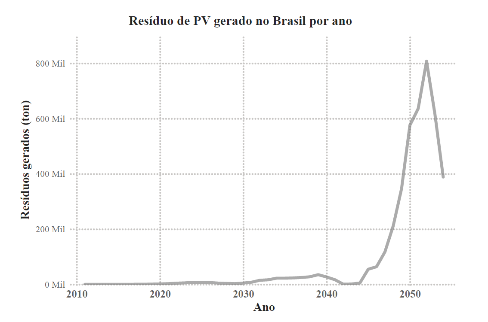
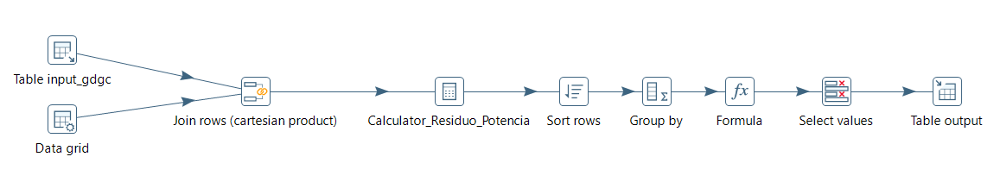

# Estimativa e Projeção da Geração de Resíduos Fotovoltaicos no Brasil por Unidade Federativa (2011–2054)

Pipeline de dados que estima quanto resíduo os painéis fotovoltaicos instalados no Brasil vão gerar ao chegar ao fim da vida útil, por unidade federativa (UF) e por ano, a partir das bases públicas da ANEEL.

**Relatório técnico completo (acesso aberto):** [https://doi.org/10.5281/zenodo.23993169](https://doi.org/10.5281/zenodo.23993169)



---

## Principais resultados

- **2025:** cerca de 6,8 mil toneladas de resíduos, com Minas Gerais (1.439 t) e São Paulo (cerca de 720 t) à frente.
- **Até meados da década de 2030:** volume baixo, porque o parque solar brasileiro é recente.
- **A partir de 2044:** crescimento acentuado, com pico projetado de cerca de 808 mil toneladas em 2052, quando os painéis instalados nos anos de maior expansão do setor chegam ao fim da vida útil.
- **MG e SP** respondem por cerca de 31% do resíduo projetado entre 2011 e 2054; as demais UFs, somadas, pela maior parte do total.

---

## Como o cálculo funciona

1. A potência fotovoltaica instalada (GD + GC) é somada por UF e por ano de instalação.
2. Uma **curva de perdas** distribui o descarte dessa potência ao longo do tempo:

   | Idade do módulo (anos) | 0 | 2 | 10 | 15 | 28 |
   |---|---|---|---|---|---|
   | Fração descartada | 0,5% | 0,5% | 2% | 4% | 93% |

3. A potência descartada é convertida em massa com o fator de **53,4 kg/kW**, obtido da média dos painéis das dez marcas mais importadas pelo Brasil em 2024 (618 W e 33 kg).

Os detalhes, as fontes e as limitações do modelo estão no relatório.

---

## Arquitetura do pipeline

```
ANEEL (CSV)  →  Pentaho Data Integration  →  PostgreSQL  →  CSV  →  Power BI
```

| Etapa | Transformação (Pentaho) | Tabela de saída (PostgreSQL) | Função |
|---|---|---|---|
| Tratamento GD | `1.pv_gd.ktr` | `gd_tratado` | Seleciona colunas, filtra usinas fotovoltaicas e extrai o ano |
| Tratamento GC | `2.pv_gc.ktr` | `gc_tratado` | Seleciona colunas, filtra usinas fotovoltaicas e extrai o ano |
| Integração | `3.pv_gdgc.ktr` | `gdgc_tratado` | Une GD e GC e agrega a potência por UF e ano |
| Cálculos | `4.pv_gdgc_calculos.ktr` | `gdgc_calculos` | Aplica a curva de perdas e converte a potência em massa |
| Consumo | `5.pv_gdgc_final.ktr` | `gdgc_final_*` | Gera as tabelas finais e exporta os CSVs |
| Visualização | Power BI | — | Gráficos do relatório |



---

## Estrutura do repositório

```
residuo_pv_pentaho/
├── consultas_sql/   # consultas usadas na discussão do relatório
├── data/
│   ├── raw/         # bases da ANEEL (não versionadas: baixar, ver abaixo)
│   └── output/      # resultados finais em CSV
├── imagens/         # figuras usadas neste README
├── pentaho/         # transformações 1 a 5 (.ktr)
└── power_bi/        # painel (.pbix) e versão em PDF
```

### Resultados (`data/output/`)

| Arquivo | Conteúdo |
|---|---|
| `gdgc_final_2025.csv` | Resíduo gerado por UF em 2025 (t) |
| `gdgc_final_porano.csv` | Resíduo total do Brasil por ano, 2011–2054 (t) |
| `gdgc_final_completo.csv` | Resíduo por UF e por ano, 2011–2054 (t) |

Os arquivos usam `;` como separador e `,` como separador decimal.

### Consultas SQL (`consultas_sql/`)

| Arquivo | O que sustenta no relatório |
|---|---|
| `ranking_potencia_instalada_acumulada_por_estado_gc_gd_total.sql` | Ranking das UFs por potência acumulada (GD, GC e total), 2011–2025 |
| `potencia_instalada_por_ano_brasil_2011_2026.sql` | Potência instalada no Brasil por ano (Tabela 6) |
| `potencia_instalada_2022_a_2026_explicacao_queda_2053.sql` | Queda das instalações em 2025, separada em GD e GC |
| `comparacao_bahia_parana_potencia_por_periodo.sql` | Por que a Bahia gera mais resíduo que o Paraná em 2025 |
| `participacao_mg_sp_potencia_e_residuo.sql` | Participação de MG e SP na potência e no resíduo |

---

## Como executar

### Requisitos

- Pentaho Data Integration 9.4
- PostgreSQL 18
- Microsoft Power BI Desktop (opcional, para abrir o painel)

### 1. Baixar os dados da ANEEL

Os arquivos originais não estão no repositório por causa do tamanho. Baixe-os no Portal de Dados Abertos da ANEEL e salve em `data/raw/` com estes nomes:

| Base | Link | Nome do arquivo |
|---|---|---|
| Geração distribuída (GD) | [Relação de empreendimentos de MMGD](https://dadosabertos.aneel.gov.br/dataset/relacao-de-empreendimentos-de-geracao-distribuida) | `GD_empreendimento-geracao-distribuida.csv` |
| Geração centralizada (GC) | [SIGA](https://dadosabertos.aneel.gov.br/dataset/siga-sistema-de-informacoes-de-geracao-da-aneel) | `GC_siga-empreendimentos-geracao-diario.csv` |

Os resultados deste repositório usam os dados extraídos em setembro de 2026. Bases baixadas em outra data podem gerar valores um pouco diferentes.

### 2. Criar o banco de dados

No PostgreSQL, crie um banco chamado `pv2026`. As transformações usam `localhost`, porta `5432` e usuário `postgres`. Se o seu ambiente for diferente, ajuste a conexão no Spoon.

### 3. Configurar a senha do banco

A senha não fica gravada nos `.ktr`. A conexão usa a variável `${PV_DB_PASSWORD}`, que deve ser definida no seu `kettle.properties`:

1. Na pasta `data-integration` do Pentaho, gere a senha criptografada:
   ```
   Encr.bat -kettle SUA_SENHA
   ```
2. No Spoon, abra **Editar > Editar o arquivo kettle.properties** e crie a variável:
   ```
   PV_DB_PASSWORD=Encrypted 2be98afc86aa7f2e4cb79ce10df90acde
   ```
   (use o valor gerado no passo anterior)
3. Reinicie o Spoon.

### 4. Executar as transformações

Os caminhos dos arquivos são relativos (`${Internal.Entry.Current.Directory}/../data/...`), então funcionam em qualquer computador, desde que a estrutura de pastas seja mantida.

Execute na ordem:

```
1.pv_gd.ktr  →  2.pv_gc.ktr  →  3.pv_gdgc.ktr  →  4.pv_gdgc_calculos.ktr  →  5.pv_gdgc_final.ktr
```

Os CSVs finais são gravados em `data/output/`.

---

## Limitações

Os resultados são estimativas de ordem de grandeza: o ano de instalação da GD vem da última atualização cadastral, a curva de perdas é baseada em estimativas internacionais, o fator de massa usa painéis de 2024 e a projeção considera apenas as instalações registradas até setembro de 2026. A discussão completa está no relatório.

---

## Como citar

CARDOSO, R. S. **Estimativa e projeção da geração de resíduos fotovoltaicos no Brasil por unidade federativa (2011–2054)**. Relatório técnico. João Pessoa, 2026. DOI: [10.5281/zenodo.23993170](https://doi.org/10.5281/zenodo.23993170).

## Licença

Este trabalho está licenciado sob a [Creative Commons Atribuição 4.0 Internacional (CC BY 4.0)](https://creativecommons.org/licenses/by/4.0/deed.pt-br). Você pode usar e adaptar o material, desde que cite a autoria.

## Autora

**Raquel da Silva Cardoso**
[LinkedIn](https://www.linkedin.com/in/raquel-cardoso-b1116162/) · raquelscardoso@outlook.com
